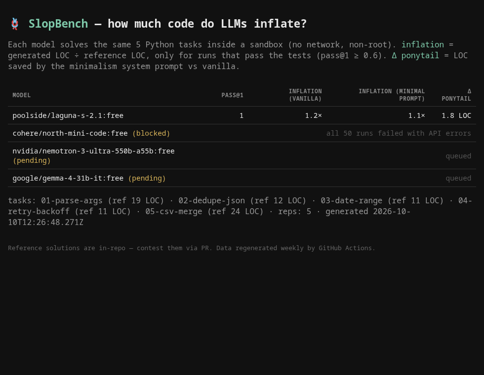

# SlopBench

[](https://github.com/DarkHater01/slopbench/actions)
[](LICENSE)

**Code benchmarks measure whether a model solves the task. None measure how much code it wastes.**

SlopBench reports two numbers per model — and one that nobody else publishes:

| metric | what it answers |
|---|---|
| `pass@k` | Can the model solve the task at all? |
| `inflation` | **How many lines does it write to do it?** |
| `ponytail Δ` | **How many lines does a minimalism system prompt shave off?** |

> Reference solutions are in-repo, hand-written, and contestable via PR. The denominator is public on purpose.

---

<a href="docs/demo.gif"></a>

---

## The number

`inflation = LOC generated ÷ LOC of the reference solution`

A model that solves a 12-line task in 96 lines has inflation ≈ 8.0×. It passed the tests. It is also responsible for the review burden every engineer using AI agents is drowning in.

**Inflation is only counted for runs that pass the tests.** A two-line obfuscated one-liner that fails nothing? It doesn't qualify. Neither does a 3-line solution that passes 1 out of 5 tries. A model must reach `pass@1 ≥ 0.6` on a task before its LOC counts there. See [ADR-001](docs/adr/ADR-001-metric.md).

<!-- LEADERBOARD:start -->
| model | pass@1 | inflation | inflation (minimal prompt) | Δ ponytail |
|---|---|---|---|---|
| poolside/laguna-s-2.1:free | 1 | 1.2× | 1.1× | −1.8 LOC |
| deepseek/deepseek-chat-v3-0324:free | _pending_ | | | |
| nvidia/nemotron-3-ultra-550b-a55b:free | 0 | — | — | — |
| meta-llama/llama-3.3-70b-instruct:free | _pending_ | | | |
<!-- LEADERBOARD:end -->

_Snapshot generated weekly by [GitHub Actions](.github/workflows/bench.yml) at `data/results.json`. Previous snapshots are in git history._



---

## Why "ponytail Δ"

Every model runs each task **twice**:

- **vanilla** — "You are an expert Python developer. Solve the task exactly as specified."
- **minimal** — "Write the least Python that fully satisfies the spec. No classes, no abstractions, no comments, no error handling beyond what the spec requires. A few clear lines beat a clever framework."

The difference in median LOC is the cheapest lever against AI bloat that any team can pull **today**, without swapping models. The number exists to be measured, argued about, and stolen.

---

## How it works

```
tasks/               5 airtight Python specs (task.md) + reference/solution.py + pytest suite
runner/run.js        model × task × variant × rep → OpenRouter → Docker sandbox → data/raw.json
runner/score.js      aggregates raw.json → data/results.json (throws on inconsistent input)
runner/test_score.js self-test of the scorer (no API required)
index.html           static leaderboard, reads data/results.json. No backend. No framework.
```

Every generated solution runs inside a container with:

- `--network none`
- `--read-only` root filesystem
- `--user 1000:1000` (non-root)
- `--memory 512m --cpus 1 --pids-limit 128`
- 50-second timeout

Code written by models is treated as hostile. It never touches the host.

**Runs are repeated 5×** per task (configurable in `runner/config.json`). If a model can't pass 5 out of 5, its `pass@5` is reported as `false` and its LOC is discarded — a solution you can't rely on isn't a solution you should count.

---

## Run it

```bash
# 1. Sandbox image (once, ~45 MB)
docker build -t slopbench-sandbox sandbox/

# 2. Offline smoke test with canned fixtures — no API key needed
node runner/run.js && node runner/score.js
node runner/test_score.js

# 3. Real run — pick your models in runner/config.json
export OPENROUTER_API_KEY=sk-or-...
node runner/run.js && node runner/score.js

# 4. Watch it live
node runner/monitor.js --watch

# 5. View the leaderboard
python3 -m http.server 8000
# → http://localhost:8000
```

A scheduled GitHub Action regenerates `data/` every Monday and commits it. The repository stays static: no backend, no database, no accounts.

---

## Add a model

```json
{ "id": "z-ai/glm-5.3-flash" }
```

in `runner/config.json → models`. That's it. Free-tier models work but will rate-limit; the runner retries with exponential backoff and records `api_error` entries rather than aborting the run.

## Add a task

A directory under `tasks/` with four files:

| file | purpose |
|---|---|
| `task.md` | the exact prompt. Be airtight: signatures, error messages, worked examples. |
| `reference/solution.py` | the minimal solution. This defines the denominator. |
| `tests/test_solution.py` | pytest. Imports `solution`. No network, no fixtures. |
| `task.json` | `{"id": "...", "language": "python", "entry": "solution.py", "test_cmd": "python -m pytest -q"}` |

Contested reference solution? Open a PR. We change the denominator if the argument is good. That's the point.

---

## What this is not

- **Not a code-quality metric.** LOC is gameable. Long average line length is flagged; a blind rubric grader is on the roadmap. We mitigate, we don't solve.
- **Not a claim that "less is always better."** A 40-line solution with clear intent beats a 12-line puzzle. But 40 lines *for a 12-line task* is the failure mode we're naming.
- **Not a leaderboard for the "best model."** The best model depends on your task. SlopBench is one axis, and only one.
- **Not affiliated with any model vendor.** Zero sponsorship, zero API-key kickbacks.

---

## Honesty

- Reference LOC is a human choice. Ours are committed and contestable.
- Free-tier models change availability weekly. Every result is a dated snapshot — see `generated_at` in `results.json`.
- Token counts are **not** compared across models (different tokenizers). LOC is the only cross-model unit that means the same thing.
- If you think a task is unfair, add a task that's fairer. The suite is designed to grow.

---

## Why this exists

Agentic coding tools are getting faster every month. The number of lines they ship is going up with them. Nobody is publishing the ratio.

SlopBench is a 5-task benchmark run for the price of a coffee, with all raw data checked in, so anyone can cite a number and anyone can contest it. It will be wrong about your favorite model. That's the deal.

---

## License

MIT. Data is public domain. Reference solutions are MIT. Use the numbers, argue with them, publish them.

---

_PRs welcome. Issues about the metric are the most welcome._